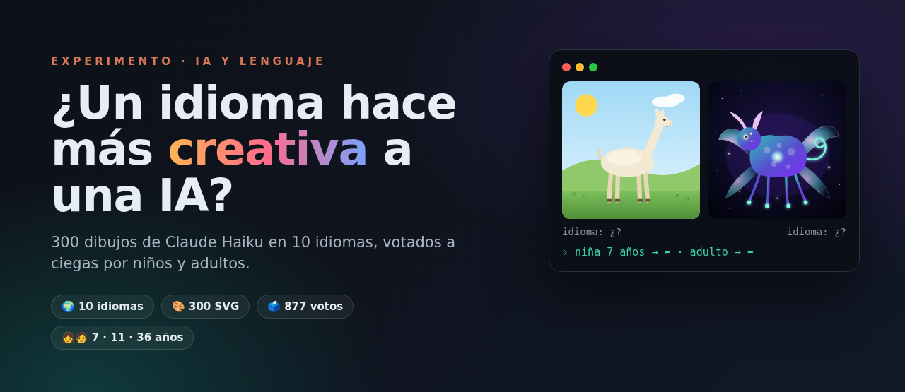
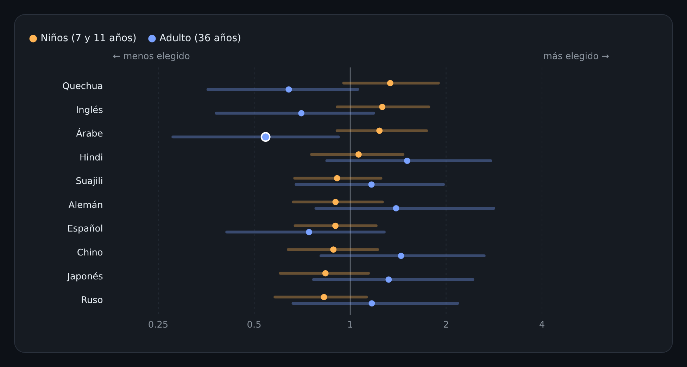
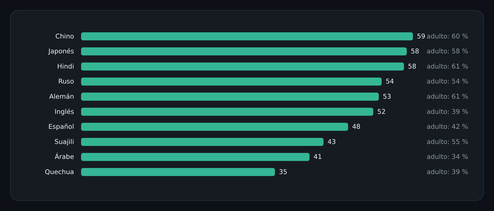
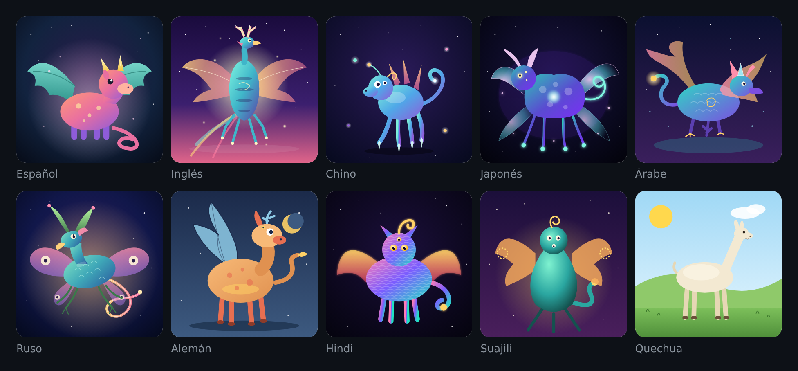
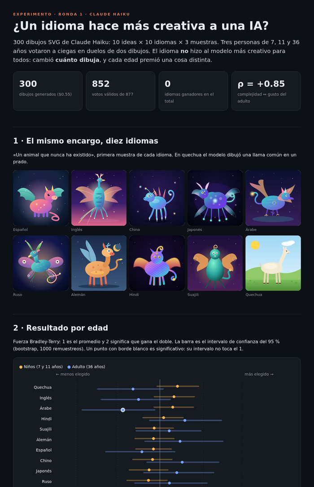

# 🌍 ¿Un idioma hace más creativa a una IA?



[](https://opensource.org/licenses/MIT)
[](https://www.anthropic.com/claude)
[](data/svg/)
[](data/votos.csv)
[](docker-compose.yml)
[](data/)

[](https://github.com/sponsors/elisaul77)
[](https://paypal.me/eflorezp)
[](https://buymeacoffee.com/elisaul77)

Le pedimos a Claude Haiku **«un animal que nunca ha existido»** en diez idiomas. En nueve dibujó criaturas con alas, cuernos y estrellas. **En quechua dibujó una llama en un prado.**

Una niña de 7 años eligió la llama. Su padre, de 36, la descartó. Ese contraste resume el experimento:

> ### El idioma no hizo al modelo más creativo. Cambió **cuánto dibuja**, y cada edad premió una cosa distinta.

```
  prompt × 10 idiomas ──► Claude Haiku ──► 300 SVG ──► duelos ciegos (mismo prompt, 2 idiomas)
                                                          │
                       niños 7 y 11 años ◄────────────────┼────────────────► adulto 36 años
                       «me gusta lo simple y bonito»      │      «me gusta lo elaborado»
                                                          ▼
                                       Bradley-Terry + bootstrap por edad
```

---

## ✨ Hallazgos

- ⚖️ **Ningún idioma gana en el total.** Con los 852 votos válidos juntos, los diez idiomas quedan entre el 46 % y el 54 % de duelos ganados, y todos los intervalos de confianza cruzan el 1.
- 🧩 **El idioma cambia la complejidad del dibujo.** En quechua Haiku pone de media **35 elementos SVG**; en chino, **59**. Árabe y suajili también salen simples. En quechua además escribe un 40 % menos (2528 tokens frente a 4204 en japonés).
- 🧑 **El adulto premia lo complejo.** Elige el dibujo con más elementos en el **59 %** de los duelos, y su ranking de idiomas sigue casi exacto el de complejidad (**ρ = +0,85**).
- 👧 **Los niños no.** A ellos la complejidad les da igual (49 % y 48 %), y por idioma van en sentido contrario (ρ = −0,49 y −0,37).
- 🔀 **Por eso los gustos se cancelan.** El ranking del niño de 11 años y el del adulto están en contra (ρ = −0,53), y el de la niña de 7 también (ρ = −0,33). Lo que uno sube, el otro lo baja.
- 🎯 **Solo dos efectos son significativos, y cada uno es de una sola persona.** A la votante de 7 años le gusta el **quechua** (71 % de duelos ganados). Al adulto **no** le gusta el **árabe** (34 %).
- 🎲 **El ganador cambia en cada idea.** «La música dibujada» la gana el chino (87 %), «el sueño» el suajili, «la alegría» el inglés. Pesa más cada dibujo que el idioma.

## 📊 Resultados



| Idioma | Todos | Niños (7 y 11) | Adulto (36) | Elementos por dibujo |
|---|:---:|:---:|:---:|:---:|
| Hindi | 54 % | 52 % | 61 % | 58 |
| Quechua | 53 % | **58 %** | 39 % | **35** |
| Inglés | 51 % | 56 % | 39 % | 52 |
| Alemán | 51 % | 47 % | **61 %** | 53 |
| Árabe | 50 % | 56 % | **34 %** ⬇ | 41 |
| Chino | 50 % | 47 % | 60 % | **59** |
| Suajili | 49 % | 47 % | 55 % | 43 |
| Japonés | 49 % | 46 % | 58 % | 58 |
| Ruso | 47 % | 45 % | 54 % | 54 |
| Español | 46 % | 48 % | 42 % | 48 |

> % de duelos ganados. ⬇ = significativo (intervalo del 95 % por bootstrap, 1000 remuestreos, sin tocar el 1). Se descartaron los votos de menos de 500 ms (25 de 877).

### Lo que de verdad cambia: cuánto dibuja



### El mismo encargo, diez idiomas



<sub>«Un animal que nunca ha existido», primera muestra. De izquierda a derecha y de arriba abajo: español, inglés, chino, japonés, árabe, ruso, alemán, hindi, suajili, quechua.</sub>

## 🧪 Cómo se hizo

```
10 ideas × 10 idiomas × 3 muestras ─► claude -p aislado ─► 300 SVG ─► web de duelos en la LAN ─► 3 votantes ─► análisis
```

| Paso | Qué | Detalle |
|---|---|---|
| Ideas | 10 encargos abiertos | animal inexistente, un sueño, la música, la casa de un monstruo amable, la alegría… ([`gen/prompts.json`](gen/prompts.json)) |
| Idiomas | es · en · zh · ja · ar · ru · de · hi · sw · qu | mezcla de idiomas con muchos y con pocos datos de entrenamiento |
| Generación | `claude -p --model haiku` | sin herramientas, sin configuración, system prompt «SVG», una sesión por dibujo; toda la instrucción en el idioma de prueba, pidiendo pensar en él |
| Votación | web propia en Docker | apodo + edad; duelos del **mismo prompt** en dos idiomas, sin decir cuáles; primero los dibujos con menos votos |
| Votantes | 3 personas de una familia | 7 años (288 votos), 11 años (341), 36 años (223) |
| Estadística | Bradley-Terry + bootstrap | prior suave (rival virtual de fuerza 1), Spearman entre votantes |

- 🙈 **Evaluación ciega.** Nadie veía de qué idioma venía cada dibujo.
- 🔒 **Sin datos personales.** Los votantes se publican como E1, E2 y E3, solo con su edad.
- 💸 **Barato.** Los 300 dibujos costaron **$0,55**.

### 📸 El informe

[](reports/informe-haiku.html)

El informe completo, con tablas por votante, el ganador de cada idea y la metodología, está en [`reports/informe-haiku.html`](reports/informe-haiku.html). Descárgalo y ábrelo en el navegador: carga los dibujos desde `data/svg/`.

## ⚙️ Reproducir

> Requiere la [CLI de Claude Code](https://claude.com/claude-code), Python 3 y Docker.

```bash
python3 gen/generar.py --modelo haiku --muestras 3 --paralelo 8   # 300 SVG en data/svg/
docker compose up -d --build                                       # votar en http://<tu-ip>:8725/
                                                                   # resultados en vivo en /resultados.html
python3 analisis/analizar.py                                       # data/votos.csv → data/stats.json
python3 analisis/informe.py                                        # → reports/informe-haiku.html
```

Para otra ronda basta con cambiar `--modelo` (`sonnet`, `opus`); la página de resultados trae un selector de modelo. Para pasar los votos de la base SQLite a `data/votos.csv` sin nombres: `docker exec idioma-creatividad python - < analisis/exportar_votos.py > data/votos.csv`.

## 📁 Estructura

```
gen/            prompts.json (10 ideas × 10 idiomas) y generar.py
app/            plataforma de votación (FastAPI + SQLite) y su web (index.html, resultados.html)
data/svg/       los 300 dibujos: haiku_<idioma>_<prompt>_<muestra>.svg
data/           votos.csv (anonimizado), generacion.jsonl (coste y tokens), stats.json
analisis/       exportar_votos.py (anonimiza), analizar.py (estadística), informe.py (informe HTML)
reports/        informe-haiku.html
docs/           imágenes de este README
```

## 🐞 Límites (con honestidad)

- **Es un piloto.** Tres votantes de la misma familia sirven para formular hipótesis, no para probarlas.
- **Un solo adulto.** «Los adultos premian la complejidad» necesita más adultos para confirmarse.
- **Votantes desiguales.** El de 11 años votó 341 veces y el adulto 223. Por eso el total se parece más al gusto de los niños.
- **Traducciones.** Las hizo Claude. En quechua el modelo pudo entender mal la idea (la llama), y eso se mezcla con el efecto del idioma.
- **Un solo modelo.** Haiku. Puede que un modelo más capaz no simplifique en los idiomas con pocos datos.

## 🔭 Lo que falta

- Más votantes adultos, para confirmar o tumbar el efecto de la edad.
- Ronda con **Sonnet** y **Opus**: ¿la diferencia de complejidad entre idiomas desaparece en modelos más grandes?
- Ronda de **imágenes** (ChatGPT, Gemini) con un paisaje en los 10 idiomas.
- Separar «creativo» de «me gusta»: preguntar también *¿cuál es más raro?*

## 🔗 Relacionado

[avoid-the-predictable](https://github.com/elisaul77/avoid-the-predictable): el experimento anterior sobre qué hace más original a un LLM (ortografía, tono y la frase «evita lo predecible»).

## 📄 Licencia

MIT para el código y los datos — ver [LICENSE](LICENSE). Los dibujos fueron generados por Claude Haiku.

## ❤️ Apoya el proyecto

Si te sirvió, considera apoyar:

[](https://github.com/sponsors/elisaul77)
[](https://paypal.me/eflorezp)
[](https://buymeacoffee.com/elisaul77)

---

<sub>La hipótesis era que algún idioma haría más creativo al modelo. Lo que salió es que cada edad ve la creatividad en un sitio distinto.</sub>
